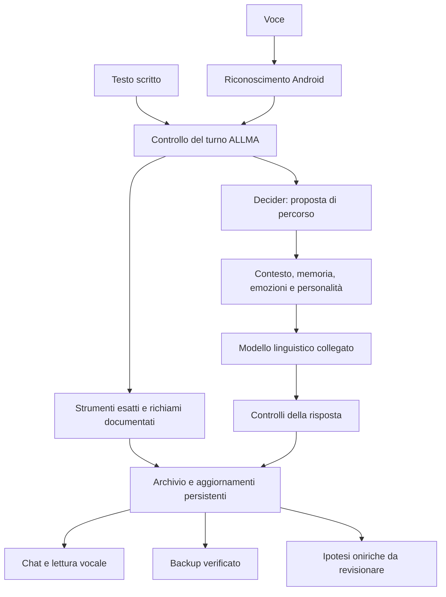

# Revisione del sistema ALLMA — 21 ottobre 2026

## Esito e perimetro

La struttura attuale separa identità persistente, storia dell'utente, strumenti esatti e modello linguistico. Questa separazione è concreta e va conservata. Sono presenti verifiche di attribuzione, revoca, scrittura atomica, recupero dell'apprendimento e interruzione delle operazioni. Restano difetti riproducibili, costi che crescono con la storia e funzioni presenti ma poco sfruttate.

Questa revisione comprende l'inventario statico dei Python destinati al pacchetto, l'esame dei percorsi principali, l'intera raccolta di test configurata e prove aggiuntive con dati sintetici. Non certifica la correttezza semantica di ogni funzione o di tutte le risposte del modello. Non è stato eseguito un nuovo collaudo Android e non sono stati letti archivi personali.

Evidenze: `/Users/erikahu/ALLMA/analisi/2026-10-21/audit-sistema/`.

| Verifica | Risultato |
|---|---|
| Inventario statico | 217 moduli Python, esclusi test e dimostrazioni |
| Raggiungibilità dagli ingressi principali tramite import statici | 142 moduli; gli altri includono anche strumenti, diagnostiche, package e ingressi alternativi |
| Errori di sintassi nell'inventario | 0 |
| Basi di import locali mancanti nel grafo principale | 0 |
| Raccolta Python completa | 2.089 casi: 2.074 superati, 15 saltati |
| Ripetizione mirata | Tre casi inizialmente bloccati dall'avvio OpenMP nella sandbox sono passati fuori dalla sandbox, con rete disabilitata |
| Controlli JavaScript autonomi | 7 script superati |

I 15 casi saltati riguardano un'immagine di prova assente, vecchie API di integrazione/progetti, una vecchia API di ragionamento e un percorso NLP non disponibile. Non vengono contati come successi. Il risultato dei test non è una percentuale di intelligenza o affidabilità universale.

Nessun codice applicativo è stato modificato per questa revisione. I difetti seguenti sono da correggere; i test esistenti passati non li coprivano necessariamente.

## Percorsi principali

È uno schema delle responsabilità principali, non l'ordine esatto di ogni scrittura interna. Il difetto F01 riguarda il percorso proattivo, che non rispetta ancora la stessa precedenza del salvataggio.

## Difetti riprodotti

### F01 — Messaggio proattivo consegnato prima della scrittura

Priorità alta. `proactive_runtime.check_initiative` invoca il callback dell'interfaccia prima di `store_message`.

La prova `probe_initiative.py` simula un errore del disco: il risultato restituito è `error`, ma il callback è già stato chiamato. Un messaggio può quindi essere mostrato senza essere ricordato al riavvio. Non è stato inviato alcun messaggio reale nella prova.

Soluzione: registrare messaggio e intento di consegna prima del callback, assegnare un identificatore stabile e riconciliare le consegne interrotte. Riutilizzare il meccanismo di aggiornamenti recuperabili esistente, senza creare un secondo archivio della conversazione.

Riferimento: `allma_model/utils/proactive_runtime.py`, chiamata `callback(event)` prima della scrittura.

### F02 — Letture energetiche vecchie possono autorizzare lavoro in background

Priorità alta. Se la lettura Android fallisce o non restituisce un intento batteria, `SystemMonitor` restituisce `last_state` senza indicarne l'età o l'errore. Il controllo del lavoro in background può quindi considerare ancora valide vecchie informazioni di ricarica e temperatura.

Prova: dopo una lettura sintetica di 90%, in carica e 35 °C, un errore JNI simulato lascia `power_allows_background=True`.

Soluzione: data monotona, provenienza e validità della lettura; oltre una scadenza breve, lavoro opzionale sospeso. Usare anche il risparmio energetico reale: il campo `is_power_save` esiste ma non viene aggiornato dal lettore Android.

Riferimenti: `allma_model/core/system_monitor.py:48`, `allma_model/utils/background_work.py`.

### F03 — Il costo del salvataggio cresce con tutta la storia

Priorità alta per la conservazione nel tempo. `store_message` chiama `save_memory`, che serializza tutte le conversazioni e tutti i messaggi in un singolo JSON, mantenendo il lock della memoria.

Misura sul Mac, tre inserimenti per dimensione, mediana; dati sintetici, indicizzazione vettoriale disabilitata per isolare il salvataggio:

| Messaggi iniziali | Archivio dopo la prova | Inserimento e salvataggio |
|---|---|---|
| 100 | 77.144 byte | 1,481 ms |
| 1.000 | 764.744 byte | 8,850 ms |
| 5.000 | 3.820.744 byte | 41,562 ms |
| 20.000 | 15.280.744 byte | 175,454 ms |

Sono misure locali di una piccola prova, non latenze Android o una previsione lineare precisa per anni di utilizzo. Confermano che ogni inserimento paga anche il costo della storia precedente. Il caricamento iniziale legge inoltre tutto il JSON in RAM; `on_pause` effettua un ulteriore salvataggio sincrono.

Soluzione: archivio transazionale con inserimenti incrementali e query paginate; migrazione verificata dal JSON, originale conservato e lettore compatibile. Snapshot e compattazione separati dalla singola risposta.

Riferimenti: `allma_model/memory_system/conversational_memory.py:566`, `:841`, `allma_model/ui/app_entry.py:123`.

### F04 — Ricostruzione completa dell'indice dopo i nuovi ricordi

Priorità media. Ogni `VectorMemoryEngine.add` rende sporco l'indice. La ricerca successiva richiama `_rebuild_index`, che legge e ricodifica tutti i record, anche di utenti diversi.

Prova: cinque cicli inserimento → ricerca producono cinque ricostruzioni complete. La rappresentazione sparsa già introdotta riduce la memoria, ma non elimina questo costo.

Soluzione: indice stabile più piccolo indice degli inserimenti recenti; ricerca combinata e fusione periodica, oppure indice lessicale persistente con aggiornamenti incrementali. Conservare isolamento, attribuzione e ricostruibilità.

Riferimenti: `allma_model/core/vector_memory_engine.py:324`, `:484`.

### F05 — Un limite della cache può togliere risposte già consolidate

Priorità media. `AnswerRecall` conserva al massimo 500 voci e rimuove la prima in ordine di inserimento, anche se confermata. Il limite è complessivo all'archivio, non una quota separata per utente.

Prova: dopo 501 risposte distinte, la prima risposta, confermata due volte, non è più nella cache. Questo non cancella la conversazione originale, ma perde la disponibilità immediata del risultato appreso.

Soluzione: separare cache veloce e deposito persistente delle risposte confermate; trasferire fuori dalla cache le meno usate senza cancellarne la conoscenza. Gestire invalidazione e revoca anche nel deposito.

Riferimento: `allma_model/learning_system/answer_recall.py:146`.

### F06 — Segnali percettivi presenti ma senza contributo alla risposta

Priorità media. Perception Lite produce ripetizioni, cambi di argomento, sequenze di domande e urgenza in un proprio formato. L'aggregatore conserva questi campi nei risultati grezzi, ma non li traduce in istruzioni o prefissi della risposta. La percezione relazionale più recente è invece collegata al prompt.

Prova: una percezione con `urgency` produce istruzioni e prefisso vuoti nell'aggregatore.

Soluzione: un contratto di segnali percettivi con evidenza, soggetto, affidabilità e durata; il piano del turno decide quali segnali usare. Non collegare direttamente i suggerimenti attuali prima della correzione F07.

Riferimenti: `allma_model/core/perception_lite.py`, `allma_model/core/module_orchestrator.py:298`.

### F07 — Urgenza rilevata per frammenti di parole e negazioni ignorate

Priorità media prima di usare questi segnali per decidere. La ricerca usa `marker in text`.

- «Descrivi un fiore colorato» produce urgenza media perché `colorato` contiene `ora`.
- «Non è urgente e non serve rispondere subito» produce urgenza alta.

Soluzione: confini delle parole, ambito della negazione, citazioni e distinzione fra urgenza della richiesta e semplice menzione. Non diminuire la correttezza di una risposta sulla base di un indizio così debole.

Riferimento: `allma_model/core/perception_lite.py:178`.

### F08 — Copertura emotiva diversa dalla copertura delle lingue vocali

Priorità media. Il rilevatore locale comprende soprattutto lessico italiano e inglese; offrire una lingua per STT/TTS non significa avere la stessa copertura emotiva.

Prove: gioia rilevata per «Sono felice» e «I am happy», nessuna etichetta per «Estoy muy feliz», «Je suis heureux», «Ich bin glücklich». Questo misura il rilevatore locale; il modello linguistico potrebbe comunque comprendere quei messaggi.

Soluzione: dichiarare la copertura per lingua, estendere negazioni e attribuzione insieme al lessico e verificare con casi indipendenti. In assenza di copertura, restituire interpretazione non disponibile, evitando di presentare l'assenza di indizi come neutralità certa.

Riferimento: `allma_model/emotional_system/emotion_analysis.py`.

### F09 — Backup incompleto delle preferenze operative

Priorità media. La selezione del modello è scritta in `model_binding.json`; le notifiche in `notifications.json`. Questi file non sono in `STATE_FILES`, da cui deriva la lista ammessa nei backup.

Prova: un backup sintetico contenente uno stato cognitivo valido esclude `model_binding.json` anche quando esiste. Questo non dimostra perdita di ricordi: riguarda configurazione e continuità dell'esperienza dopo un ripristino.

Soluzione: classificare esplicitamente le preferenze portabili, validarne lo schema e includerle nel formato. La selezione del modello va ripristinata come preferenza da verificare sul nuovo dispositivo; i permessi Android devono essere verificati nuovamente, senza dare il consenso per acquisito.

Riferimenti: `allma_model/utils/runtime_storage.py:8`, `allma_model/ui/webview_bridge.py:849`.

## Limiti progettuali e rischi osservati nel codice

### F10 — Decider resta in RAM durante l'inattività in primo piano

Priorità media. Viene liberato quando l'app passa in background, viene disabilitato, incontra determinate condizioni termiche o chiude. Non ha però un rilascio a tempo durante l'inattività in primo piano. Il file pesa 529.297.504 byte; questa dimensione non equivale alla RAM effettiva del processo.

Soluzione: misurare memoria e costo del ricaricamento, poi introdurre un rilascio adattivo. Includere Decider nel bilancio complessivo con modello conversazionale e voce, senza ricaricarlo inutilmente a ogni turno.

Riferimenti: `decision_runtime.py`, `allma_core.py:4002`.

### F11 — Cancellazione del decisore solo ai confini della valutazione nativa

Priorità media. I controlli prima e dopo `native.eval(tokens)` scartano correttamente un risultato annullato, ma non interrompono la singola valutazione mentre è in corso. La durata reale residua sul telefono non è stata misurata in questo audit.

Soluzione: introdurre l'interruzione nativa dove supportata, oppure valutazioni suddivise con controlli e un limite di ammissione. Misurare distintamente «risultato scartato» e «CPU realmente fermata».

Riferimento: `allma_model/agency_system/decision_engine.py:111`.

### F12 — Caricamento nativo duplicato nel ramo di recupero dell'import

Priorità media. Dopo un `ImportError` e un recupero riuscito, `_load` costruisce un'istanza `Llama` nel ramo di recupero; il codice prosegue poi fino alla seconda costruzione ordinaria. È un rischio di tempo e picco di memoria in quel ramo, individuato dal flusso del codice, non un crash Android appena riprodotto.

Soluzione: risolvere gli import in una funzione e costruire il modello una sola volta. Chiudere esplicitamente ogni candidato fallito. Sostituire le modifiche globali di `Llama.save_state/load_state` con un adattatore circoscritto quando possibile.

Riferimenti: `allma_model/llm/mobile_gemma_wrapper.py:364`, `:474`.

### F13 — Core e collegamento UI concentrano troppe responsabilità

Priorità media. `allma_core.py` ha 4.012 righe e `_process_message_turn` 1.405. Il bridge WebView ha 1.083 righe, lo script principale 2.354. Routing, recupero, prompt, validazione, persistenza e casi speciali sono intrecciati.

Soluzione: estrazione graduale, protetta dalle prove esistenti, di ammissione del turno, piano, costruzione del contesto, generazione, validazione e consegna persistente. Non serve una riscrittura totale per correggere F01–F09.

### F14 — Memoria semantica e apprendimento hanno un perimetro più ristretto dei nomi

Il recupero usa TF-IDF, sinonimi e concetti espliciti: è economico e utile, ma non garantisce la comprensione di qualsiasi parafrasi. Il richiamo confermato include anche una chiave di contesto precisa, quindi una risposta imparata non è automaticamente generalizzata a ogni formulazione equivalente.

Personalità e coalescenza apprendono significati e tendenze su assi definiti; la curiosità corrente seleziona suggerimenti a partire da segnali lessicali e ruota fra pochi inviti. Nessuno di questi percorsi addestra continuamente i pesi GGUF o quelli vocali. Sono limiti da rendere espliciti, non ragioni per rimuovere i controlli sull'apprendimento.

Soluzione: misurare il trasferimento a parafrasi mai viste e costruire collegamenti verificati fra esperienze e strategie. Non promuovere una somiglianza o una risposta generata a fatto personale certo.

### F15 — Notifiche funzionanti non equivalgono a iniziativa autonoma ad app chiusa

Il percorso proattivo corrente richiede `_foreground=True`; la pausa ferma i sogni e annulla il lavoro pertinente. `service.py` è ancora dichiarato nella build, ma la ricerca statica non ha trovato un avvio dal percorso UI. Contiene inoltre un vecchio modello fisso Qwen 2.5, percorsi predefiniti e un `SystemMonitor` non configurato per Android.

Soluzione: mantenere il servizio disattivato finché non è riallineato allo stato gestito. Se si vuole iniziativa in background, progettare un'attivazione leggera e consensuale che condivida lo stesso archivio e gli stessi controlli, senza avviare un secondo cervello concorrente. Nessuna garanzia di attività continua va dedotta dalla semplice presenza del servizio nel manifesto.

Riferimenti: `allma_model/utils/proactive_runtime.py:11`, `allma_model/ui/app_entry.py:109`, `service.py`.

### F16 — Codice precedente, ingressi alternativi e import rotto fuori dal grafo principale

Sono presenti più famiglie di project tracker, memorie, personalità e generatori di risposta. Una parte è adattata o alternativa, non necessariamente inutile. L'import `allma_model.data.vocabulary_data` di `core/vocabulary.py:81` non ha una base locale presente. Non è sul grafo statico principale, quindi non spiega un errore corrente della chat.

Gli asset del precedente avatar restano nel pacchetto: `avatar_mesh.js` circa 2,07 MB, non caricato dall'HTML attuale. Si può ridurre la dimensione della distribuzione separando gli asset storici; non ne segue un risparmio della CPU mentre la schermata è aperta.

Soluzione: registro dei componenti con stato «operativo», «osservativo», «diagnostico», «alternativo», «precedente». Rimuovere dal pacchetto solo dopo controllo degli import dinamici e delle compatibilità. Aggiornare anche la documentazione tecnica principale, che descrive ancora percorsi BERT/Spacy diversi da quello mobile attuale.

### F17 — Test numerosi, ma alcune integrazioni e la qualità reale restano fuori misura

I test saltati non devono scomparire dal bilancio. Le prove sintetiche verificano bene controlli e persistenza, ma non la qualità libera, l'accuratezza di ogni lingua, il consumo termico, la batteria o migliaia di turni reali. La precedente generazione sull'arcobaleno ha richiesto circa 24,44 s del solo modello: la fluidità vocale non elimina quell'attesa.

Soluzione: migrare o archiviare esplicitamente i vecchi test; separare i punteggi software da quelli del modello. Usare un insieme di casi mai utilizzati per tarare regole, dialoghi con correzioni e prove Android ripetibili a condizioni comparabili.

### F18 — Adattamento ai modelli e processo di release da completare

Il binding nativo GGUF esiste e la separazione identità/modello è reale. Il ragionamento e alcuni percorsi di compatibilità restano però specifici delle famiglie provate: un nuovo GGUF non è automaticamente compatibile solo perché contiene un template.

La pipeline GitHub produce APK debug; `p4a.branch=develop` non fissa una revisione della toolchain. Il calcolo dell'impronta in `build_android_safe.py` non comprende esplicitamente i sorgenti Java e tutti i binari AAR. Questo è un limite della verifica degli ingressi, non la prova che l'APK attuale sia obsoleta. Per la voce naturale restano inoltre le verifiche di distribuzione delle dipendenze già annotate nei relativi avvisi.

Soluzione: piccoli profili di capacità per modello verificati con prove dedicate; versione della toolchain fissata; impronta completa degli ingressi; percorso di release distinto dal collaudo debug.

## Idee da sviluppare

1. **Memoria su più livelli, con una sola fonte dei fatti.** Eventi persistenti indicizzati, cache recente, risposte consolidate e archivi storici compattati. Il contenuto esce dalla RAM senza perdere provenienza, correzioni e revoche. Questo affronta insieme F03, F04 e F05.
2. **Piano del turno con costi misurati.** ALLMA sceglie quali risorse chiamare in base al compito e ai dati hardware validi. Decider interviene quando c'è un'incertezza utile da risolvere; strumenti esatti e richiami documentati restano rapidi. Registrare costo del routing, recupero, generazione e voce separatamente.
3. **Traccia dell'apprendimento visibile all'utente.** Una vista degli stati esistenti mostra «cosa ho appreso», «da quale esperienza», «quanto è confermato» e «cosa cambierebbe correggendolo». Non un nuovo database parallelo e non una percentuale inventata di maturità.
4. **Curiosità basata su domande aperte reali.** Conservare poche questioni non risolte collegate alle esperienze; sceglierle per novità, utilità e costo, rispettando una chiusura dell'argomento. Una domanda non è utile solo perché contiene «perché» o è lunga.
5. **Lessico vocale personale verificato.** Apprendere correzioni esplicite di nomi e termini, con contesto e revoca; sfruttare il riconoscitore se supporta suggerimenti. L'eventuale apprendimento acustico resta un progetto separato, da confrontare con memoria e batteria.
6. **Confronto controllato delle decisioni.** Su scenari sintetici e riproducibili confrontare il percorso scelto da ALLMA/Decider con quello necessario e il costo risparmiato. Un decisore vale per gli errori evitati o le risorse risparmiate, non per il numero di volte in cui si accende nella visualizzazione.

## Ordine consigliato

1. F01 e F02: consegna persistente dell'iniziativa e validità dei sensori.
2. F03–F05: crescita della memoria, indice incrementale e conservazione delle risposte consolidate, con migrazione protetta.
3. F06–F08: percezione collegata ma correggibile, negazioni e copertura linguistica dichiarata.
4. F09–F12: completezza della configurazione nei backup, risorse del decisore e caricamento nativo.
5. F13–F18: separazione graduale dei ruoli, misura della qualità, pulizia dei componenti precedenti e release riproducibile.

La visione resta in fondo alle priorità, come richiesto in precedenza. Questo audit non propone di completarla prima della robustezza della memoria e dei percorsi correnti.
