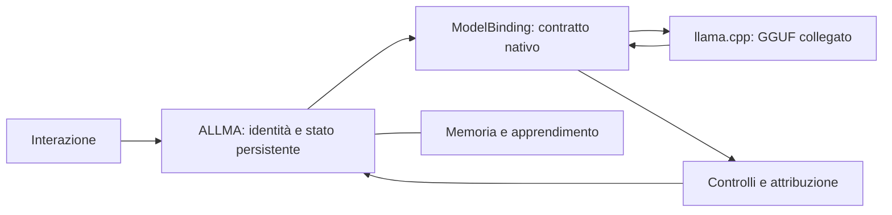

# ALLMA e il modello: collegamento nativo — 13 ottobre 2026

ALLMA conserva nome originario, cronologia, memoria, apprendimento, preferenze e revisioni oniriche. Il GGUF è un motore sostituibile: non fornisce automaticamente un'identità o ricordi autobiografici.

## Intervento

`allma_model/llm/model_binding.py` legge architettura e chat template dai metadati GGUF. Il template è renderizzato in un ambiente Jinja sandboxed, con i token BOS/EOS nativi e gli eventuali token di fine turno presenti nei metadati. La generazione usa token speciali del template una sola volta, senza aggiungere un BOS duplicato. Formati mancanti o non supportati producono un errore esplicito anziché essere trattati silenziosamente come Qwen.

La chat principale consegna messaggi strutturati al motore. La riduzione della cronologia viene eseguita prima della generazione nel formato nativo, preservando richiesta corrente e contratto identitario. Gemma riceve il contratto come preambolo del primo messaggio utente perché le sue convenzioni user/assistant non prevedono normalmente un ruolo system. I percorsi interni precedenti vengono adattati dal wrapper tramite un ponte dai prompt ChatML oppure da un semplice messaggio testuale. Non tutte le stringhe legacy nel core sono state eliminate: il ponte evita che il modello diverso riceva automaticamente il vecchio formato.

Il ragionamento dedicato viene abilitato per l'architettura Qwen3 o per una capacità dichiarata esplicitamente. I modelli senza questa modalità non ricevono un prefisso think forzato. Il parsing preserva la separazione fra ragionamento e risposta. Il profilo di campionamento Qwen3 viene scelto dall'architettura nativa, anche se il file è rinominato; modelli sconosciuti ricevono parametri conservativi, non una calibrazione di qualità automaticamente provata. La capacità dichiarabile qui usa il protocollo think: altri protocolli di ragionamento richiedono un adattatore esplicito.

Il caricatore non sceglie più il file più grande quando manca quello atteso. Un GGUF unico può essere selezionato; più alternative richiedono una scelta esplicita. Il file predefinito già presente resta la scelta iniziale prevista. Un modello selezionato in precedenza ma ora mancante non viene sostituito di nascosto.

## Ciclo di vita e selezione

API `core.switch_model('nome.gguf', reasoning=None)`: rifiuta il cambio durante chat, benchmark o sogni e quando il motore è soltanto preso in prestito. Chiude il motore precedente prima di caricare il candidato, evitando due modelli contemporaneamente in RAM. Ricollega i consumatori chat/ragionamento/sogni; salva nome e capacità in `model_binding.json` soltanto dopo il caricamento. Se fallisce tenta di ricaricare il precedente. Se anche il ripristino fallisce, segnala indisponibilità e conserva lo stato personale.

La chiusura del core libera il modello solo se ne è proprietario. Il core temporaneo del benchmark non può liberare il motore della chat. Shutdown e sostituzione sono coordinati; non si avvia un cambio su un core chiuso. Nessun reset di memoria, pesi, preferenze, identità o apprendimento durante la sostituzione.

Le API sono operative nel backend Python; non è stato aggiunto un selettore/importatore di GGUF nell'interfaccia Android. Per collegare un file nuovo deve essere già disponibile nella directory dei modelli e deve essere invocata la selezione esplicita. Non viene scaricato un secondo modello in questo intervento.

## Diagnostica del confine

`core.probe_model(message, max_tokens=..., thought_budget=..., seed=...)` esegue un dialogo minimale isolato con lo stesso motore, senza cronologia personale e senza apprendimento. Restituisce risposta grezza finale e metadati, consentendo confronti successivi con la pipeline ALLMA. È una diagnostica backend dedicata, non una seconda generazione per ogni messaggio della chat. Per confronti validi il chiamante deve allineare budget, seed e condizioni e distinguere i controlli di ALLMA dal testo grezzo del motore. Non è stato ancora eseguito un confronto cognitivo A/B sul telefono.

## Verifiche e limiti

Suite completa: **834 superati, 15 saltati, 5 warning**, 120,54 s. Successivi controlli sul coordinamento dello shutdown verificati con **60 test mirati superati**, 7,59 s. Coperti template Qwen3/Gemma/altro, assenza di template, token speciali non duplicati, preservazione del contesto, selezione ambigua, cambio riuscito, ripristino dopo fallimento, protezione del motore condiviso e diagnostica senza scritture personali. Nel sandbox alcuni test che importano PyTorch abortiscono prima dell'esecuzione: la suite completa è stata eseguita offline fuori sandbox.

Le prove su motori alternativi sono simulate: non certificano l'inferenza reale di un secondo GGUF. La compatibilità rimane vincolata alla versione nativa di llama.cpp, all'architettura, al template e alle risorse del telefono. Un futuro formato o una nuova architettura possono richiedere l'aggiornamento del runtime. Visione, tool calling e protocolli di ragionamento diversi non sono automaticamente supportati da questo contratto testuale.

APK compilata, payload corrispondente ai sorgenti, architettura arm64-v8a. SHA256 `3bad459cc010056c0ef2f4491a54e32179ed6f623931c1d96537c2f2255a2abd`. Prima installazione e collaudo nativo completati; esiti descritti sotto. Nessuna percentuale di miglioramento cognitivo misurata.

## Collaudo e ulteriore correzione strutturale

Prima APK installata con `-r`, hash sul telefono corrispondente, processo 25650. Inizializzazione del binding riuscita; risposte reali con native_architecture=qwen3, native_template=true, reasoning_supported=true e stop nativo. Il percorso completo di generazione funziona, ma alla richiesta «Quanto fa 18 + 24? Rispondi solo con un numero» il modello ha prodotto `36` in 37,39 s. Il formato numerico è valido, il contenuto aritmetico è errato: il successo del protocollo non è un successo cognitivo. La successiva risposta conversazionale ha completato il percorso in 6,72 s. Il nome originario resta fornito da ALLMA, non dai pesi del modello.

È stato quindi aggiunto `utils/exact_calculation.py`: una capacità strutturale generale, non risposte memorizzate alle domande del benchmark. Valuta un sottoinsieme limitato di espressioni aritmetiche tramite AST e Fraction, senza eval, chiamate di funzione o accesso a nomi/attributi. Supporta operazioni di base, parentesi e potenze limitate; produce soltanto risultati esatti rappresentabili come decimali finiti entro i limiti. Le richieste di spiegazione, gli intenti ambigui e i risultati che richiedono approssimazione restano nel percorso linguistico. La divisione per zero è un errore esplicito, non un numero inventato.

La risposta di calcolo ha source=verified_calculation, knowledge_verified=true, llm_used=false: non viene spacciata per una risposta appresa dal modello o per un ricordo personale. Le domande vengono conservate nella cronologia come prima; nessuna cancellazione di vecchi messaggi. Questo controllo non risolve la correttezza scientifica generale, la logica aperta o le ripetizioni semantiche del modello.

Suite completa con calcolo: **850 superati, 15 saltati, 6 warning**, 112,99 s. Ultima verifica mirata dopo consolidamento dei turni consecutivi Gemma e del topic di calcolo: **77 superati**, 7,52 s. Nuova APK finale compilata e installata; la precedente prova aritmetica errata non viene conteggiata come miglioramento della qualità.

APK finale con calcolo e consolidamento Gemma compilata e verificata: SHA256 `98b946e9251052da37a90a871dfead96da5d189de68e9da2fa8f4396f32d4bbb`. Installazione `-r` riuscita, hash sul telefono identico, processo 8496. Collaudo manuale finale completato: alle 21:29:45 il messaggio aritmetico riceve `42`, source=verified_calculation, llm_used=false. Fra salvataggio della domanda e della risposta intercorrono 42,17 ms: è una misura interna di archivio, non del tempo di rendering sullo schermo. Alle 21:31:25 «Come ti chiami» riceve «Mi chiamo ALLMA.», source=origin_identity, llm_used=false; intervallo interno 55,37 ms.

La conversazione successiva evidenzia problemi ancora aperti: «Cosa sai fare allma?» produce una descrizione inesatta delle capacità, inclusa l'affermazione di non poter parlare naturalmente, in 25,29 s. Alla richiesta «Solo questi sai fare?» il modello ripete sostanzialmente la risposta precedente; il controllo blocca il testo con status=dialogue_repetition dopo 40,32 s. Il log generico lo presenta come inference failed, ma il metadato specifico documenta un rifiuto del controllo sulle ripetizioni. «Come stai?» richiede 36,31 s. La batteria raggiunge 42 °C nell'ultima generazione. Questi risultati non dimostrano che tutti i problemi residui dipendano soltanto dal modello: occorre ancora verificare descrizione delle capacità operative, contesto, attesa iniziale e dialogo. Un sogno interrotto durante la prova viene registrato come generazione interrotta; non è una verifica conclusiva del ciclo onirico.

Riferimento di protocollo: [llama-cpp-python v0.3.16 — chat formatter](https://github.com/abetlen/llama-cpp-python/blob/v0.3.16/llama_cpp/llama_chat_format.py).
