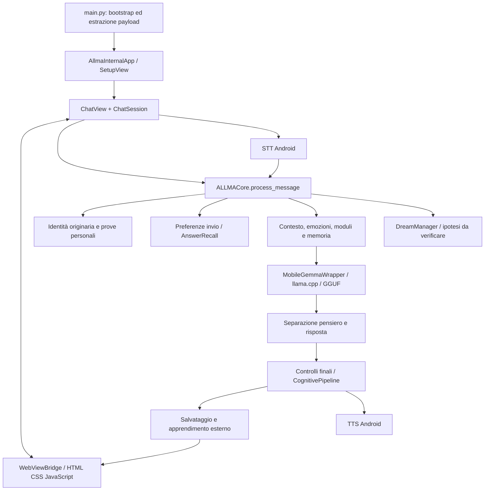

# Struttura attuale di ALLMA — 6 ottobre 2026

## Esito e perimetro

ALLMA oggi è un'app Android locale con un motore linguistico GGUF, memoria persistente, recupero di risposte confermate, regole identitarie, stato emotivo, voce nativa e interfaccia WebView. Il percorso principale è collegato e funzionante; l'architettura conserva però componenti di più generazioni e alcune capacità descritte nei nomi dei moduli sono solo parzialmente implementate.

Questa analisi è strutturale: inventario AST dell'intero pacchetto Python, grafo degli import, lettura dei collegamenti principali e dei componenti critici, confronto del payload incorporato con i sorgenti e riproduzione isolata di un difetto del recupero appreso. Non equivale a verifica dinamica di ogni ramo, a revisione semantica di ogni riga o a collaudo completo sul telefono. Nessun codice applicativo modificato, nessuna sostituzione di modello, nessuna cancellazione di dati.

### Evidenze raccolte ora

- **237 file Python**, inclusi test e demo nel pacchetto `allma_model`, per **53.785 righe**. I test nella cartella radice `tests` sono aggiuntivi e non compresi in questo numero.
- Lo strumento del progetto censisce **189 moduli** escludendo le directory `tests`, ma comprende alcuni test/demo al livello superiore: non sono 189 moduli tutti di produzione.
- **91 moduli raggiungibili** dai tre punti principali attraverso import statici. Gli altri 98 richiedono classificazione: import dinamici, percorsi alternativi, demo o legacy. Non sono automaticamente codice morto.
- Nessun errore di sintassi nei file Python del pacchetto analizzati.
- **162 sorgenti Python destinati al payload** verificati: tutti presenti e identici nel `ZIP_DATA` attuale di `main.py`.
- Nessun corpo lungo di funzione identico rilevato dal confronto AST. Ci sono comunque duplicazioni di responsabilità, che questo controllo non misura.
- Sette basi di import locali mancanti in due demo e nel vecchio `core/vocabulary.py`.
- Riproduzione di due errori in `AnswerRecall` su JSON di prova: `records` lista provoca `AttributeError`; record privo di `user` provoca `KeyError`.

Il precedente collaudo sullo stato corrente registra **530 test passati, 15 saltati e 23 controlli browser passati**. Questi sono risultati precedenti, non una suite rieseguita durante questa analisi. La configurazione pytest non impone una soglia di copertura (`--cov-fail-under=0`) e non raccoglie automaticamente tutti i vecchi script di prova nella radice del repository.

Inventario per file, classi e import: [inventario-moduli.md](/Users/erikahu/ALLMA/analisi/2026-10-06/struttura/inventario-moduli.md). Dati strutturati, grafo e verifica payload sono nella stessa directory.

## Mappa del percorso principale

Il diagramma è logico: la preview progressiva può arrivare prima dei controlli finali dell'intera risposta. Il testo finale sostituisce la preview.

## 1. Avvio, distribuzione e interfaccia

`main.py` avvia una schermata esterna, decodifica un archivio ZIP Base64, rimuove e ricrea `allma_brain_v163`, estrae codice e risorse e importa `AllmaInternalApp`. Quest'ultima apre un secondo setup per verificare il modello e poi `ChatView`.

`pack_brain.py` rigenera l'archivio incorporato. È una dipendenza reale del flusso di build: modificare un sorgente senza rigenerare il payload può distribuire una versione vecchia. Il confronto attuale non rileva differenze. Il bootstrap riestrae il payload a ogni avvio; non ho trovato una condizione di riuso basata sull'hash in questo percorso.

Il payload ha 186 file e circa 24,36 MB non compressi. `allma_model/core_data.png` ne occupa circa 20,67 MB: non risultano riferimenti testuali nei sorgenti del pacchetto. È un candidato da investigare, non un file dichiarato eliminabile senza ulteriori verifiche.

La UI corrente usa Kivy/KivyMD per avvio e integrazione Android e una WebView per chat, pannelli e grafica vocale. Le vecchie schermate KV nella cartella radice `ui` rappresentano un ulteriore percorso storico. Lo stile corrente e le modifiche alla voce sono in `assets/web`.

`ChatSession` gestisce un turno attivo, ID richiesta, cancellazione e cambio conversazione; il bridge passa dati tra Python e JavaScript. Il rendering progressivo è aggregato e non simula una digitazione a caratteri. Resta il polling del bridge ogni 350 ms, distinto dal rendering a richiesta dei frammenti.

## 2. Pipeline delle risposte

`ALLMACore` concentra inizializzazione, routing, storia, emozioni, memoria, moduli, costruzione prompt, generazione, validazione, apprendimento e schedulazione. Ha oltre 3.300 righe; `process_message` supera le 1.000. È il principale punto di accoppiamento e di difficoltà di manutenzione.

Il percorso del turno è:

1. Controllare la cancellazione e segnalare utente attivo ai sogni.
2. Registrare comandi espliciti sulla consegna dei messaggi, se presenti.
3. Rispondere a richieste identitarie/personali supportate da prove, senza modello.
4. Applicare feedback o recuperare una risposta già confermata, quando la chiave corrisponde.
5. Caricare il GGUF se necessario; recuperare storia, topic e contesto.
6. Elaborare stato emotivo, ricordi, moduli moderni e adapter legacy.
7. Costruire prompt e budget; generare pensiero e risposta.
8. Filtrare identità e affermazioni personali; applicare la pipeline cognitiva.
9. Salvare risposta, metadati, candidati al recupero e dichiarazioni utente.

I vecchi commenti parlano di una generazione «single-pass». Il comportamento effettivo con budget di pensiero è più preciso: **una richiesta ALLMA genera due stadi nativi**, uno per il pensiero e uno per la risposta, in `bounded_completion`. Se il pensiero raggiunge il limite, viene inserito il confine `</think>` e avviata la risposta. Non è un secondo tentativo di riscrittura, ma può comunque comportare ulteriore prefill.

Il routing della complessità è prevalentemente a espressioni regolari, lunghezza e intent. SIMPLE e NORMAL condividono normalmente il limite totale di 256 token, COMPLEX usa 512. Pensiero tipicamente 64/128 token, ridotto in base al totale disponibile. Il caso «in dettaglio» non è coperto in modo generale: una richiesta lunga di storia delle biciclette nel collaudo ha ottenuto 256 token ed è stata troncata. È una lacuna di routing/budget oltre che un limite possibile del modello.

## 3. LLM, RAM e prestazioni

Il modello attuale è **Qwen3-1.7B-Q8_0**, 1.834.426.016 byte, scaricato da revisione fissata e verificato con SHA256. I nomi `Gemma` del wrapper e la chiave `gemma` del downloader sono storici: non identificano il modello realmente caricato.

Il percorso principale inizializza llama.cpp **su CPU**, `n_gpu_layers=0`, mmap attivo, batch 512, contesto nativo fissato a 2048. Il wrapper accetta `n_ctx` ma il ramo principale usa letteralmente 2048: rendere configurabile il contesto richiede correggere questa incoerenza, non solo cambiare l'argomento del costruttore.

Normalmente si usano quattro thread Android, con sei in determinate condizioni iniziali di carica e temperatura. La scelta è fatta all'inizializzazione; non è un regolatore continuo dei thread durante ogni turno.

Le cache di stato sono limitate a due conversazioni, con capacità configurata di 256 MiB ciascuna. Questo non significa 512 MiB sempre allocati, ma è un budget importante da profilare rispetto all'obiettivo di RAM contenuta. La cache di prompt è un'accelerazione tecnica e non un apprendimento della risposta.

Il prompt combina una finestra fino a 20 messaggi con contesto variabile, mentre il contesto nativo è piccolo. Occorre verificare il bilancio con tokenizzazione reale e una politica esplicita di selezione della storia, evitando di affidarsi soltanto a troncamenti in caratteri.

La ricetta Android usa `llama-cpp-python` 0.3.16 e tag llama.cpp predefinito `b5092`. Un GGUF di architettura nuova non è automaticamente compatibile: modello, template e versione nativa vanno verificati insieme prima della sostituzione.

La cancellazione è cooperativa. Funziona tra i risultati nativi, ma il prefill può ritardarla. Il collaudo ha misurato generazioni da 10,44 e 17,23 secondi su due prove e temperature CPU fino a 67,5 °C su una terza. Non prova riduzioni di consumo o temperatura rispetto al passato.

## 4. Memoria e apprendimenti: che cosa cambia davvero

| Sistema | Responsabilità attuale | Persistenza / limite |
|---|---|---|
| OriginIdentity | Nome originario ALLMA | Costante separata dai ricordi |
| ConversationalMemory | Messaggi, conversazioni e fatti estratti | JSON, scrittura atomica |
| VectorMemoryEngine | Recuperare messaggi pertinenti | SQLite + indice TF-IDF in RAM |
| TemporalMemorySystem | Interazioni e contesto temporale | SQLite |
| KnowledgeMemory | Conoscenza archiviata | SQLite; non verifica da sola la verità |
| IncrementalLearner | Unità, confidenza, feedback e progressi | JSON versionato |
| AnswerRecall | Recuperare risposte confermate | JSON, due conferme indipendenti come soglia predefinita |
| MessageDelivery | Preferenza progressivo/completo/auto | JSON per utente; comandi espliciti |
| IdentityStateEngine / IdentityManager | Stato di maturità, stabilità e conflitti | Stato principalmente in RAM; `db_path` non basta a renderlo persistente |
| NeuroplasticitySystem | Regole testuali e conteggi di attivazione | RAM, bootstrap vuoto; nessun addestramento del GGUF |

**Il file GGUF non viene addestrato durante le conversazioni.** I «pesi» di confidenza, tratti, utilità e regole sono stato dell'applicazione. ALLMA può cambiare nel tempo mantenendo lo stesso modello, ma ciò non equivale a un fine-tuning o all'acquisizione generalizzata di abilità nei pesi linguistici.

`AnswerRecall` usa una chiave con utente, domanda normalizzata, ultimi turni pertinenti e contesto/lingua. È un recupero conservativo dipendente dal contesto, non una comprensione semantica di tutte le parafrasi. Ripetere una domanda due volte non basta: servono conferme; feedback negativo disabilita il recupero. La conferma umana non costituisce verifica indipendente della correttezza.

La memoria «vettoriale» è TF-IDF lessicale con espansione di alcuni sinonimi, non un encoder semantico neurale. A ogni modifica l'indice può essere ricostruito; i vettori sono densi e la ricerca usa una matrice temporanea. Con mesi di conversazioni il costo in RAM e CPU deve essere misurato su corpus grandi.

### Persistenza ancora incompleta

La memoria principale Android è spostata in `files/allma_state`, separata dal codice sostituibile. **Rettifica verificata durante l'implementazione:** una classe locale `KnowledgeMemory` nascondeva quella importata da SQLite; la coalescenza conservava quindi i concetti in RAM, non nel database relativo `Model/data/allma.db` inizialmente ipotizzato. Il diario usava `allma_diary.json` relativo e scrittura diretta. Questi collegamenti richiedevano persistenza e migrazione; i concetti già perduti dalla RAM non sono recuperabili retroattivamente. Le correzioni successive sono documentate in `MIGLIORAMENTI_STRUTTURA_2026-10-06.md`.

`IdentityStateEngine` riparte da maturità 0,5 e stabilità 0,9; `IdentityManager` conserva un TODO di caricamento DB; `NeuroplasticitySystem` non carica/salva le regole. La personalità di coalescenza viene inizializzata nuovamente e il salvataggio del diario non è un ripristino completo dei tratti. La storia conversazionale persistente non implica persistenza di tutto lo stato cognitivo.

## 5. Emozioni, identità e moduli sovrapposti

`EmotionalCore` integra rilevamento emotivo e `SoulCore`. Quest'ultimo e i moduli «volition», «entropy» e «proprioception» implementano stati e formule computazionali: i nomi biologici non dimostrano emozioni vissute o coscienza.

Il nome ALLMA è protetto separatamente; fatti personali e cronologia hanno controlli sulle fonti. Questo rispetta la distinzione richiesta fra conoscenza del modello e vissuto dell'app. I filtri sono però regole linguistiche, non un verificatore universale delle affermazioni personali o della correttezza fattuale.

`ModuleOrchestrator` registra nove moduli e usa un budget di 500 ms. Non è un timeout nativo: controlla il tempo prima di avviare il modulo, ma un singolo modulo lento può sforare. `LegacyBrainAdapter` esegue inoltre un pulse separato prima dell'orchestratore: il budget non copre automaticamente questo lavoro e tutta la preparazione del turno.

Duplicazioni di responsabilità confermate:

- curiosità, creatività, pianificazione e meta-apprendimento moderni più corrispondenti legacy;
- più sistemi di personalità (`core`, coalescenza, adapter e `personality_system`);
- più implementazioni di memoria sotto `memory_system`, `core/memory_system` e `incremental_learning`;
- project tracker in `project_system`, `project_tracking`, `core` e altri percorsi storici;
- due famiglie di preferenze utente;
- bootstrap alternativo `core_modules.init_runtime_modules` e `core_bootstrap.ensure_initial_knowledge`, senza chiamanti trovati nel pacchetto corrente;
- bridge API alternativo che crea moduli propri oltre al core, quindi non condivide automaticamente lo stesso stato;
- generatori di risposta storici accanto al percorso GGUF principale.

La soluzione è assegnare una responsabilità autorevole a ogni servizio e migrare gradualmente i chiamanti. Non eliminare intere cartelle sulla sola base del grafo statico.

## 6. Voce, visione e sogni

La voce effettiva passa da `STTEngine` e `TTSEngine` Android, con gestione delle sessioni, JNI, cancellazione e callback. `VoiceSystem` determina pitch e velocità; il suo metodo `speak` è solo logging e non il motore usato dalla UI. La risposta parlata attende il finale validato: lo streaming della chat non rende automaticamente progressivo il TTS. Il percorso STT preferisce on-device quando disponibile, senza garantire offline su ogni telefono e motore.

`VisionSystem` è incompleto: senza VLM restituisce mock basati anche sul nome del file; con client presente la chiamata reale resta non implementata. Non va presentato come riconoscimento reale di immagini. La via che utilizza questo modulo va resa esplicitamente indisponibile fino all'integrazione di un VLM.

I sogni correnti producono ipotesi separate dalla conoscenza verificata, con carica richiesta, energia almeno 72%, batteria non oltre 40 °C, priorità alla chat e cancellazione. Il ToT usa profondità uno e genera un nodo con punteggio fisso: non è una ricerca ramificata che valuta soluzioni concorrenti. Non risultano chiamanti del metodo che estrae le ipotesi da confermare; manca un flusso completo di revisione/promozione.

Restano da implementare checkpoint delle memorie già elaborate e un criterio di pianificazione più esplicito: il worker esclude le ore 07–09 ma non è un sistema di sonno notturno completo. Il servizio `service.py`, pur dichiarato in build, non viene avviato dal bootstrap attuale; usa un vecchio Qwen2.5 e storage separato. Attivarlo ora rischierebbe duplicazione di modello e stato. L'EventBus è in-process e non è una comunicazione tra due processi Android.

## 7. Background e consumo

Esistono coordinatore asyncio, pool di lavoro, bus, compattazione memoria e scheduler sogni. Separano il lavoro dalla UI, ma i thread non riducono da soli il consumo.

Il GC controlla ogni minuto e può compattare messaggi oltre 30 giorni per tempo trascorso o pressione RAM. Può chiamare il modello per estrazione: non condivide i vincoli di carica/temperatura dei sogni e controlla l'attività utente prima dell'avvio, senza la stessa cancellazione cooperativa durante la generazione. Inoltre sceglie il primo utente disponibile anziché pianificare tutti gli utenti. È un lavoro da profilare e coordinare, non una pulizia automaticamente gratuita.

## Interventi prioritari

| Priorità | Intervento | Risultato atteso / verifica |
|---|---|---|
| Alta | Validare schema e singoli record di AnswerRecall | Un JSON malformato non interrompe la chat; prove negative e fallback |
| Alta | Uniformare DB, diario e stato evolutivo | Migrazione conservativa e prova riavvio/aggiornamento senza perdita dei tratti |
| Alta | Correggere routing, bilancio prompt/pensiero/risposta | Richieste dettagliate non troncate arbitrariamente; nuovi casi oltre al benchmark |
| Alta | Coordinare ogni lavoro LLM in background | Unica ammissione energetica, priorità utente e cancellazione; misure reali |
| Alta | Rendere esplicita l'indisponibilità della visione mock | Nessuna descrizione inventata presentata come osservazione |
| Media | Introdurre configurazione modello e template per architettura | Cambio GGUF sicuro senza dipendere da nomi Gemma/Qwen o tag rigidi |
| Media | Profilare cache, indice TF-IDF e corpus grandi | Budget RAM basato su misure; indice più compatto e ricerche scalabili |
| Media | Ridurre sovrapposizioni moderni/legacy | Meno lavoro duplicato, stato condiviso e responsabilità chiare |
| Media | Chiudere il ciclo di verifica sogni | Ipotesi revisionabili, provenienza, conferma e checkpoint |
| Media | Separare il core in servizi conservando il contratto | Routing, contesto, generazione e salvataggio testabili separatamente |
| Bassa | Razionalizzare bootstrap, payload e asset non referenziati | Avvio più semplice e meno duplicazione, dopo verifica dei percorsi dinamici |
| Bassa | Archiviare demo e import rotti; aggiornare commenti | Documentazione coerente e suite realmente rappresentativa |

## Valutazione conclusiva

Il valore di ALLMA è nel collegamento tra modello, memoria, identità e interazione. La pipeline Android principale è più solida del materiale legacy che le sta intorno. Non è però ancora un'architettura cognitiva completamente persistente né un sistema che impara nuove abilità modificando autonomamente il modello.

Un modello migliore può aumentare la qualità delle risposte, ma non corregge storage separati, stato evolutivo perso al riavvio, routing errato, mock visivi o lavoro LLM non coordinato. Questi problemi vanno affrontati insieme alla scelta del modello, con prove controllate e senza cancellare la storia dell'utente.
